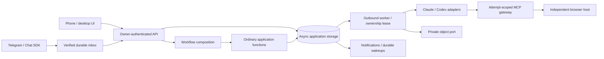

# Architecture and the Eve reference

The delivery state and remaining external gates are in
[implementation-checklist.md](implementation-checklist.md); configuration and
reproduction commands are in [operations.md](operations.md). Decision: Vercel
Workflow is the initial engine. The Pi is the first control-plane deployment
target, reached privately through Tailscale; hosting the UI/API on Vercel is optional. Eve is an architectural reference, not a runtime
dependency. Temporal remains a future composition adapter.

## Transport, application and execution

`packages/core` contains JSON domain values, pure admission/cron rules and execution
ports. It imports no Node, storage, provider or engine SDK. `packages/storage`
implements async transactions for local SQLite and Prisma/PostgreSQL. Checkpoint,
object and runtime functions have no Workflow directives or SDK context. Only
`apps/web` composes Workflow steps/timers/hooks and Chat SDK/Sandbox adapters. The
worker runs native provider execution outside an engine step, so engine retries
cannot implicitly repeat an agent's external effects.

[Eve's architecture](https://github.com/vercel/eve/blob/main/packages/eve/README.md#architecture-internals)
separates channels, harness execution and durable orchestration. We retain that
separation and the independent lifetimes of conversations and compute. A session
is a durable record, not a warm process. Eve owns a model/tool loop; our native
Claude/Codex process owns its loop, so an engine cannot replay it instruction by
instruction. Its [decoupling proposal](https://github.com/vercel/eve/issues/512)
is useful design context, not a runtime contract copied into this codebase.

## Durable input, ownership and outcomes

A workspace owns instructions and resource policy. A session owns its provider,
native lineage, conversation, read cursor and checkpoint reference. A turn owns
one submitted instruction. Multiple pending inputs are allowed, with a 100-message
waiting limit and exactly one running turn per session. Claims exclude earlier
pending/queued inputs, even if engine dispatch happens out of order. Waiting
messages hold no agent processes or machine reservations.

Accepted input and its pending dispatch state commit together under a stable client
ID. The dispatcher may start duplicate engine runs after an acknowledgement loss.
Each run registers its own completion waiter, but enqueue/claim execute the same
application turn only once. Workflow history contains IDs and small status values,
not transcripts, files, raw credentials or browser state. A Workflow run per turn
bounds engine history and lets subsequent turns use a newer deployment without
changing application session identity.

The worker acquires an increasing generation, materializes its execution directory
and checkpoint, streams ordered events, heartbeats, and checkpoints progress.
Worker capacity reports are distinct from active-turn heartbeats. Both have
bounded timeouts; a missing heartbeat fences old writes and gateway admissions.
Only Demo work is replay-safe and automatically recovers from its checkpoint.
Interrupted native execution becomes interrupted and needs explicit continuation;
its original external effects may already have happened.

Completion persists result/checkpoint before acknowledgement. A repeated completion
returns the stored outcome. Terminal transactions also record unread attention,
notification outbox entries and durable engine wakeups through equivalent SQLite
and PostgreSQL triggers. Wakeups resume per-run hooks rather than polling Workflow
steps every five seconds. If completion wins the race with waiter registration,
the later workflow reads an already-terminal record and exits without waiting.
Local development reconciles through one unreferenced timer in the existing web
process; hosted functions use request `after()` plus authenticated cron repair.

Worker RPC uses the static `/api/worker?action=...` route, with the same scoped
credential and assignment checks for JSON, file reads and encrypted uploads.
The former `/api/worker/[action]` endpoint remains compatible with older workers.
Next dev runs static-path discovery for dynamic routes, even for these POSTs;
using the dynamic endpoint for frequent polls started repeated analysis processes.
Restart upgraded workers to move their traffic to the static endpoint. This does
not change the Workflow engine or its protected internal routes.

Stopping pending/queued input is immediate. Running work stays Stopping until its
worker acknowledges or loses its lease. Stop racing completion wins and prevents
decision publication; it cannot retract an in-flight website request. Interrupt and
send records the stop and follow-up together. The follow-up waits for the earlier
execution to release ownership. No implicit native steering/resume is assumed.

## Persistence and portability

`SqlDatabase` is an async, bound-parameter transaction port. SQLite remains an
optional lightweight local adapter; an async per-file gate avoids blocking the
Node event loop between independent connections. PostgreSQL uses Prisma's `pg`
adapter, a three-connection pool and serializable transactions with bounded conflict
retries. Application SQL is fixed code; values remain bound. The adapter handles
identifier quoting, SQLite's scalar MAX and binary-length expressions explicitly.
Schema migrations preserve partial uniqueness, queue indexes and atomic attention.
Supabase is a deployment host only: no Supabase SDK/Auth/Realtime/extension coupling.

A read-only SQLite export and fresh-database PostgreSQL import preserve identifiers,
ordering, revisions and sequence positions. Import refuses populated tables and
verifies all content before commit. Object files and encryption keys are separate
recovery inputs. Real backup retention, off-device recovery and release rollback
procedures must be tested on the chosen infrastructure.

File checkpoints are bounded manifests with hashes and attachment references;
attachments remain in the object port rather than inflating every checkpoint.
Current limits are 512 checkpoint files / 4 MiB file content and 16 MiB of mirrored
Claude native entries per session. These are prototype data limits, not limits on
other applications. Default CLI state remains on its provider's local store.
Codex cross-host native export is still unimplemented; same-host continuation is
supported. A native ID alone never restores another host's files/authentication.

Large transport messages are encrypted authenticated payloads in the private object
port, with short-lived grants bound to worker/turn/generation/purpose. Payloads over
1 MiB use direct object upload/download on S3-compatible storage, so native images
and checkpoints do not exceed hosted function body/response limits. Encryption keys
travel only over the authenticated worker channel and are not stored beside the
objects or in Workflow history. The object payload is temporary transport; the
committed application/native records remain canonical. Local objects provide the
same flow for fixtures. Transfers are bounded at 64 MiB, checksummed, authenticated
before decoding and revalidated against current ownership. Configure temporary-
object lifecycle cleanup separately from durable attachment retention.

## Native runtimes and credentials

The default adapters start CLI processes on demand and exit after a turn. Codex
uses `exec`/`exec resume` with workspace-write policy and ignored user configuration.
Claude uses print/resume, explicit MCP configuration, `dontAsk` and narrow file
publication permissions. Unsupported permission prompts are denied; durable input
questions use the harness MCP tool and finish the native process instead of
keeping it alive indefinitely. CLI environment filtering omits control-plane,
Telegram and cloud-administration secrets. Claude API-only bare mode is opt-in;
its default path retains account login support.

The opt-in Claude SDK adapter implements the engine-independent
`NativeSessionStore` append/load/subkey port with a stable harness project namespace.
Native entries are ordered, UUID-deduplicated and checked against the assigned
session. A durable file checkpoint records its matching native revision; a newer
partial transcript invalidates that checkpoint for relocation. Actual provider
entitlement, authentication renewal, ARM64 behavior and real-host transfer remain
provider-specific gates. Cross-provider conversion is a handoff, not lossless
native continuation. No entire provider auth directory is copied into checkpoints.

Owner authentication, worker enrollment, attempt tool grants and browser control
leases are separate identities. Hosted owner access uses OIDC/PKCE and a subject or
verified-email allowlist, with hashed expiring revocable sessions. Missing settings
fail closed. The private launcher hides internal engine routes; on Vercel the
Workflow build integration preserves queue-consumer protection. A deployed app
must verify that protection and its production authentication before real access.

Secret policies name references and environment bindings. A backend port resolves
only currently granted references, audits issuance without values, and rechecks
ownership/policy before delivery. The initial backend maps to deployment secret
variables; another engine can replace it without changing runtime contracts.
Known secrets are redacted across output chunk boundaries and mirrored strings;
file checkpoints reject known granted secret bytes. These controls do not make a
secret invisible to a process that is authorized to use it, nor prevent deliberate
encoding/exfiltration. Revocation affects future fetches; an existing process must
be stopped and the underlying credential revoked when necessary.

The ordinary Mac worker is a trusted same-user process. An optional Linux supervisor
container drops each native session to a separate UID/private home and keeps its
own credential outside those permissions. Environment filtering alone is not
filesystem isolation. Real provider binaries and the deployed container still
need an isolation/security validation; this is not a multi-tenant security claim.

## Memory, artifacts and fresh context

Shared accepted decisions use revisioned history with withdrawals. Each turn
proactively receives the current bounded snapshot in context and local decision
files, including relevant cross-workspace findings; models need not discover a
hidden DECISIONS.md in another session. They can call `memory_get` again during a
turn. Publication uses expected revisions and transactional receipts so a stale
update cannot silently replace a newer decision. Limits are currently 100 records
and 32 KiB of injected context.

This remains an application-canonical decision service, not the future git-backed
knowledge repository. Selective audiences, git/skill ingestion, retrieval indexes,
subscriptions and enforcement at every model/tool boundary remain separate work.
The system does not claim to identify every stale belief inside a model. Existing
Litho/vault/provider-session migration stays deferred.

Attachments are immutable scoped records with durable object references, binary
hashes and upload receipts. UI paste/drop/picker share the same flow. Workers
materialize both current and earlier session attachments on relocation, and only
current image attachments become new native multimodal input. Other formats are
explicit file paths, not presumed model-native formats. Credentials, execution
homes and attachment byte copies are excluded from portable file manifests.

Agent defaults are application settings stored through the repository port.
They select the agent and a separate preferred model for each provider, and seed
new sessions only. Session model changes retain provider/native IDs. Turn creation
atomically snapshots the session's model; execution overrides the session view
with that snapshot, so later changes cannot affect waiting/running turns. A null
model delegates to the worker/provider default. Model IDs are data passed as
individual SDK/CLI arguments, never shell command fragments. Workflow carries no
provider-specific selection logic. Both SQLite upgrades and Prisma migration 10
add nullable model columns without rewriting native checkpoints.

File-picker and drag/paste handlers snapshot browser file lists synchronously.
Clearing an input or leaving a drop event can invalidate its live FileList before
a deferred React update reads it. Upload receipts and worker binary integrity
checks remain unchanged; PDFs use the existing generic document file path.

## Scheduling, attention and channels

Cron calculation is engine-independent and stores an IANA timezone. Natural-language
requests become inactive agent proposals with the exact prompt and destination;
the owner reviews the exact revision, edits it, or approves activation. A revisioned
Workflow timer sends an occurrence into the normal session input queue. The default
destination is the creating conversation; the UI can select another existing or
one dedicated persistent conversation. A new session is not created per occurrence.
Missed and overlapping recurring reviews coalesce, old timers are invalidated, and
one-time reminders post text without an agent worker.

Terminal attention has monotonic read sequences. Clients clear only the snapshot
they actually displayed and cannot clear a newer result accidentally. Input/login/
schedule review requests add a needs-input state. Unread/needs-input sessions sort
first and collapsed workspaces aggregate their badges. Manual pencil titles are
separate from asynchronous cheap utility naming, so automatic naming cannot
overwrite a manual choice. No title operation starts a full agent process.
Native agents also receive a session-scoped `session_title` tool and the current
title/source. They can refine generated titles in the existing turn without a
separate model call; a conditional update always preserves manual titles. The
offline fallback selects bounded topic words; configured cheap utility naming
remains independent and optional.

Owner decision edits and deletions use expected revisions and append to accepted
history. Deletion is a null-content withdrawal, which still invalidates old
conversation beliefs. Earlier source links remain in history; the owner-created
revision retains workspace provenance without attributing it to an agent turn.
Restoration appends another revision. No physical history purge is exposed.

The Codex adapter explicitly approves tools on its attempt-scoped harness MCP
server. This is separate from CLI `approval_policy=never`, which otherwise rejects
MCP calls needing a prompt. It changes no global CLI configuration or shell
sandbox permissions. The gateway still validates ownership, workspace policy and
tool arguments, and schedule activation remains available only through owner
review. Claude retains its existing narrowly scoped MCP allow rule.

Telegram uses the official Chat SDK adapter and PostgreSQL state without Redis.
Ingress verifies the webhook and owner/chat allowlists, commits a durable inbox
before acknowledgement, then hands the update to the adapter. Application input
handling and its inbox receipt share a transaction, avoiding the adapter's early
update-ID acknowledgement gap. Replies use the same persistent session input path;
`/stop` uses its control path. Session-to-topic mappings are durable. A small native
bridge creates/renames topics; ambiguous creation waits for inspection rather than
creating another topic automatically. Notification delivery is a separate outbox
with retries/receipts and authenticated UI links, and does not mark a session read.

## Browser identity and optional capacity

### Agreed target: browser resources on any eligible worker

Browsers are worker resources with placement independent of agent execution. A Mac,
Pi, other compatible machine or provisioned Sandbox can host a browser resource;
any authorized agent can use it through the browser gateway. A worker can host only
browsers, only agents or both. Advertise browser/runtime capabilities, architecture,
health, memory/CPU/browser-slot budgets and resource lifetime. Placement selects a
resource satisfying the requested identity, authorization and task requirements.

A browser identity records the authorized account/profile and supported durable
state; its current host is a placement detail. A lease fences control and assigns
session-owned tabs. Host-independent adapters use Patchright to connect through a
paired extension/local relay or supervise a managed browser. Screenshots, encrypted
manual takeover, resource policy and the operation ledger share the gateway path.
Extension support is validated per host; managed headless browsers can satisfy
resource requests on compatible Pi/Sandbox runtimes without a desktop extension.

An offline host affects resources bound there. Other eligible resources remain
usable. Failover requires the requested identity to exist or supported state to be
restored and validated; otherwise pause the dependent task. Ephemeral browser
resources publish their lifetime and persist checkpoints/artifacts/supported state
externally. Browser allocation and idle cleanup are independent of agent slots.
Unknown external outcomes and interrupted native execution are not replayed merely
because a different resource becomes available.

This target is documented in [Browser resources across workers](browser-connection-options.md).
Explicit resource registration/bindings, per-resource placement and extension
adapters remain implementation work. In particular, the current global preference
for personal Chrome must become an identity/resource-specific choice.

### Initial deployment login policy (2026-10-23)

No browser task should require the Mac to remain online. Each eligible host keeps
its own persistent browser login state. When the selected host is signed out,
request interactive takeover for password/MFA entry on that host, including the
Pi. Reuse valid sessions rather than asking on every task. Do not copy personal
Chrome credentials or require an unlocked password vault. Password-manager
automation is deferred; an optional future 1Password integration adds no current
subscription requirement. Host relocation may require a new login and must still
respect native interruption and unknown-outcome safeguards. This is the agreed
policy; actual Pi takeover and host-loss behavior remain validation gates.

### Current implementation

A browser identity is independent of the agent worker. One eligible host/controller
owns it at a time. Patchright starts only on demand and closes idle contexts. Browser
access is available in every workspace without an enable step. Legacy stored
`browser:false` values are ignored on read without rewriting other resource
settings. Availability alone does not impose a browser execution profile or
prevent Sandbox placement; an explicit browser task still needs suitable capacity.
Managed browser hosts are headless by default. Mac workers with Chrome installed
now default to `extension`. The Meta Harness Browser extension is loaded once and
paired to the browser host's local worker with `pnpm browser:pair`. A small
in-process loopback WebSocket/CDP relay authenticates that profile, binds its
extension origin and connects the pinned Patchright client. Browser commands only
reach extension-created background tabs. The extension never activates a tab or
focuses a window; `Page.bringToFront` is a no-op. Chrome's normal extension debugger
indicator can remain visible, but remote-debugging connection dialogs are not part
of this path. The bridge rejects profile cookie export and browser-wide mutation
commands. Existing authenticated state is used in place, not bundled/exported.

Pairing and automatic reconnect survive worker relay restarts. Idle cleanup closes
owned tabs while retaining an approved transport; worker shutdown disconnects the
client and local relay without exiting Chrome. An unpaired resource reports the
one-time setup steps; a previously paired offline browser asks for that profile to
be opened, not another login or pairing. The profile pairing credential is a local
restricted file and is not sent in worker reports, model context, URLs or git.

Set `HARNESS_BROWSER_BACKEND=extension` on another compatible browser host to use
this adapter. The extension is not Mac-specific. Use `managed` for isolated
persistent/headless profiles. The older `personal-chrome` permission-based CDP
adapter remains an explicit diagnostic option, not the default. It requires
Chrome's remote-debugging Allow prompt; normal setup should not recommend it.

Browser reads include bounded accessibility text, omitting form input values.
They wait up to five seconds for the site's `aria-busy` loading markers to clear;
an unfinished load is explicitly labeled as a partial snapshot, not absent data.
`sheet_read` fetches the current signed-in Google Sheet's `htmlview/sheet` content
within Chrome, preserving gid and account selection. The HTML shell alone contains
no rows. Inert HTML parsing runs on the worker, outside the page's Trusted Types
policy; no script executes and the site's policy is unchanged. Returned rows,
columns, bytes and text are bounded. It neither publishes the sheet nor changes
cells. Canvas editor text alone is not proof of cell access.
Agent navigation URLs remain limited to 4 KB. Browser resource requests allow up
to 64 KiB for applications such as Calendar, whose data-request URLs exceed 4 KB;
both paths reject embedded credentials and private/control-plane addresses.
Agent/browser workers may differ; identity-aware resource placement beyond the
current worker report/broker selection remains planned.

The browser card is hidden until explicitly opened or a human-control/login
request needs attention. The composer provides an Open browser button.

Tool operations use stable logical IDs and a session-scoped ledger; old generations,
stopped turns and manual-control leases reject new agent admissions. Unfinished
operations are supplied to later turns and can be queried; unknown outcomes require
external reconciliation. Arbitrary websites do not provide exactly-once effects.

Browser hosts explicitly mark failures before action execution as `not_started`.
The tool handler persists those as failed and does not overwrite them in its catch
path. An explicit later tool call can retry the same logical operation ID with a
new physical command attempt; original failed commands remain in history. Worker
fencing, session scope and argument hashes still apply. This is not automatic
replay of an interrupted native agent. Errors after action execution starts stay
unknown unless there is a completion receipt. Legacy Chrome-connection failures
are reconciled only when the failed command contains the exact pre-execution
connection error; generic failures/timeouts are insufficient evidence.

The UI receives screenshots/URL and can take over the same browser for login/MFA.
The initial transport is an encrypted JPEG/input relay, a measured alternative to
noVNC that needs no extra VNC daemon or public CDP/WebSocket port. Only the UI and
browser worker hold its ephemeral transport key. Agent input/model capture pause
during manual control; return clears the manual view and submits a continuation.
Worker enrollment/browser generations and input IDs make retries/failures explicit.
Managed-profile cookies and supported local storage are encrypted outside the database key backup;
OS/hardware-bound auth, full profiles and service-specific relocation remain gates.

Sandbox is optional, cold and disabled by default. A workspace capacity policy plus
deployment configuration allow provisioning only compatible work. The manager
bounds vCPUs, concurrent jobs, rolling-day starts and lifetime, uses a prepared
pinned image, and enrolls an expiring identity scoped to one turn. Provider secrets
are fetched only for that owned turn. Browser-dependent/non-portable work waits;
finished/expired capacity revokes and stops. Actual cloud startup/auth/connectivity,
timeouts, spending and teardown must be validated before enabling real tasks.

## Google owner authentication

`HARNESS_AUTH=google` selects Better Auth independently of `HARNESS_HOSTED`.
The local Pi can retain SQLite; no additional DB connection or daemon is needed.
Google's authorization-code flow uses the configured canonical origin and exact
callback `/api/auth/callback/google`. Require a verified email from the explicit
owner allowlist at profile acceptance and on every protected request. Password
signup, account linking and direct client ID-token login are not exposed.

Better Auth validates encrypted eight-hour session cookies. The existing hashed
`owner_sessions` ledger makes revocation immediate across processes/restarts;
Google access/refresh tokens are not retained in an account cookie. Legacy token
login, owner bearer tokens and old owner cookies cannot bypass Google mode.
Worker keys and attempt-scoped tool identities keep their separate auth paths.

Only the required auth endpoints pass the public gateway. Google mode forces that
gateway even for a loopback listener behind Caddy; Next/Workflow callbacks remain
on a separate private port. Trust only the configured origin for browser writes.
The gateway replaces caller-supplied proxy IP headers before auth rate limiting.
Missing selected-mode settings fail closed. Google mode is enabled only after the
origin, provider client and owner allowlist have been configured.

## Coding repositories and handoff (agreed follow-up)

Coding sessions bind repository URLs, isolated worktrees, branch/upstream,
base/head commit IDs and current PR URLs/numbers. A local commit is portable only
after pushing or bundling its git objects; the next host restores the exact
revision. An unconstrained pull can select a different revision.

Dirty state includes the index, unstaged changes and untracked files. Capture it
consistently with execution files and native provider state, or retain worker
affinity and pause if that host disappears. Record handoff readiness and uncertain
external effects. A clean tree does not imply that interrupted native execution
can be automatically retried. Begin with transfers at safe turn boundaries.

The session header should show linked repo/PR chips, branch, clean/dirty state and
current worker. Expand for commit IDs, per-repo details and handoff blockers. A
session may use multiple repositories and PRs. These are tracked implementation
requirements, not guarantees of the current generic file checkpoints.

## Temporal boundary

A Temporal adapter can compose the existing enqueue/outcome, schedule occurrence,
input, ownership and checkpoint functions through workflows/activities. It must
translate cancellation/timeouts, reconcile durable wakeups, drain existing runs
and preserve application session identity. Native execution retries remain disabled
unless its external effects and checkpoint semantics prove replay-safe. A new
import alone is not a migration. No second orchestrator currently owns a session.

## Deleting workspaces and sessions

Owner-confirmed deletion atomically removes dependent conversation records, tasks,
schedules, attachments, checkpoints, channel bindings and pending notifications.
Deleting a workspace cascades through all its sessions and its managed browser
identity. Removing the ownership records immediately rejects old worker actions;
active native processes abort on their next heartbeat. Deletion cannot retract
an external action already in flight.

A durable cleanup outbox cancels orchestration runs, removes object bytes and
stops associated Sandboxes outside the database transaction. Workers remove their
session directories/browser profiles once they reconnect and no affected agent
is executing. Offline worker caches are not remotely erased while unreachable.
Provider-managed CLI history, backups and messages already delivered to Telegram
are outside this deletion operation. Published shared decisions remain canonical;
source session/turn links are detached, and the workspace ID remains historical
provenance. A persistent bootstrap marker prevents deleted default workspaces
from being recreated after a restart.
