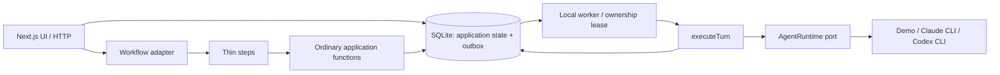

# Local architecture and the Eve reference

Decision date: 2026-10-16. The initial engine is Vercel Workflow; engine migration
is a design constraint, not a reason to build a second orchestration framework.

## Separate transport, orchestration, and execution

[Eve's internal architecture](https://github.com/vercel/eve/blob/main/packages/eve/README.md#architecture-internals)
separates channels, harness execution, and durable runtime responsibilities. Our
corresponding boundaries are HTTP/UI, the runtime adapters and application
functions, and the Workflow composition root. Eve also keeps the sandbox and
durable conversation lifetimes independent. We borrow that principle: an idle
session is a record, not a resident process.

No SDK types, directives, or implicit workflow context enter `packages/core`,
`packages/storage`, or `packages/runtimes`. Workflow IDs are optional correlation
references on a turn, not session identities. Checkpoints and arguments must be
plain serializable values. Processes, database connections, and credentials are
constructed at the execution boundary, never passed through workflow history.

Eve also emphasizes human-readable instructions and capabilities authored on disk.
We should adopt Markdown workspace instructions and skills when adding the
knowledge repository. The current local slice stores workspace instructions in
SQLite; this is explicitly not yet the git-backed configuration ingestion design.

## Borrow patterns before adopting the whole framework

[Eve's execution model](https://github.com/vercel/eve/blob/main/docs/concepts/execution-model-and-durability.mdx)
owns the model/tool loop and checkpoints steps within turns. A native Codex/Claude
process owns its own loop. Wrapping that process in a Workflow step would not make
its individual tool calls replay-safe. Our workflow only dispatches and observes
the local job; the worker owns provider execution. An interruption is surfaced
rather than automatically repeating unknown effects.

Eve's [proposal to decouple its loop from durable orchestration](https://github.com/vercel/eve/issues/512)
is a useful reference for this boundary. It is a proposal, not a guarantee about
the current implementation. We do not copy its internal APIs or add an Eve runtime
dependency to this slice. Evaluate an Eve-backed agent as another runtime adapter
when we want a custom model/tool loop, or use Eve more directly if that becomes
the primary product direction.

Patterns to retain:

- Session identity is independent of transport, provider-native ID, and workflow run.
- Compute can stop while the conversation remains available.
- Skills are optional context, tools are executable functions, and transports own
  request authentication rather than delegating it to instructions.
- Waiting for a human eventually becomes a durable waiting state, rather than a
  provider process kept alive indefinitely.

## Why a workflow per turn here

The original design and Eve use long-lived session workflows. This local slice
uses a workflow per turn, with session serialization enforced transactionally by
the application. It keeps engine history bounded by one turn, allows new code
for subsequent turns, and avoids making the application session dependent on a
particular orchestration run. Native provider state survives between processes.

This does not yet implement input queues, steering, approval requests, or durable
timers spanning turns. Revisit a session coordinator when those requirements
arrive, while retaining application-owned session identity.

## Migration and deployment

Workflow's [Postgres World](https://workflow-sdk.dev/worlds/postgres) is another
self-hosted option for the Pi: Postgres backs workflow state and Graphile Worker
processes queued work in a long-lived process. It is distinct from the managed
Vercel World used on Vercel. The local development path does not require Postgres;
adding that backend later requires compatible package versions, schema bootstrap,
startup wiring, and an explicit restart/replay test. It does not itself replace
the application's separate SQLite persistence adapter or worker protocol.

Build/debug acceptance gates are part of choosing the engine: a clean build,
an incremental build, a cache-hit build, a real local workflow/worker smoke test,
restart with an accepted pending turn, and inspection of its actual run records.
Eve remains a separate evaluation so bundler and runtime failures can be isolated
before adding another framework layer.

For Temporal, create TypeScript workflow/activity wrappers around `enqueueTurn`
and `readTurnOutcome`, or use Temporal activity workers to execute `executeTurn`.
Keep stable turn IDs, ownership fencing, and idempotency in application storage.
Activity retries must never blindly rerun native agent work. Translate engine
timeouts/cancellation explicitly, drain existing runs or import application
checkpoints, and test those semantics; replacing imports alone is insufficient.

For hosted Vercel, replace local SQLite with networked persistence, replace the
local-only outbox timer with durable hosted dispatch, enroll remote workers over
an authenticated API, and use hooks for prompt completion notification plus
reconciliation. Local CLI credentials stay on workers. A hosted function cannot
read this machine's SQLite database or local provider session store.

## What remains to validate

Actual provider subscription authentication, live continuation, checkpoint
portability, browser state, ARM64 hosts, and hosted network connectivity need
their own compatibility spikes. This slice does not imply those guarantees.

## Distributed prototype (2026-10-17)

`ControlStore` extends the original SQLite adapter with tasks, workers, scoped
credential hashes, event deduplication, claim deduplication, and checkpoints.
Workers use authenticated HTTP and have no runtime dependency on the central
SQLite file. Local startup uses the database only once to enroll a local identity.

Admission is an ordinary pure function in `core/scheduling`. The control plane
performs admission and claims in one transaction, ordered by priority and age.
Memory/CPU reservations and host headroom are estimates, not OS resource limits.
A task's provider session remains independent of its orchestration run.

Worker events carry a turn ID, generation, and contiguous sequence. Network
retries reuse the same sequence/content; conflicting reuse fails. Claims also
carry a stable request ID so a lost claim response cannot silently claim a second
job. Completion acknowledgements are idempotent. Heartbeats and mutations are
bound to both generation and enrolled worker identity.

The Demo runtime checkpoints execution files between deterministic steps. The
manifest includes file checksums, rejects symlinks and unsafe paths, and has fixed
size/file-count bounds. Publishing the checkpoint and its accepted output in one
SQLite transaction defines the replay boundary. Only Demo requeues automatically
after a lost lease. Native provider turns remain interrupted; same-provider
native-state transfer is a separate compatibility gate.

The disposable bench uses two actual HTTP worker processes and separate execution
caches, but both run on the developer machine. It establishes protocol behavior,
not hardware, provider authentication, Pi compatibility, or Sandbox networking.

## Experimental Claude session store

The optional SDK adapter implements the native SessionStore contract behind the
engine-independent `NativeSessionStore` port. SQLite preserves entries in append
order, deduplicates UUID-bearing entries, and keeps subagent subkeys separate.
Writes and reads require current worker ownership. Batch IDs make HTTP retries
idempotent; SDK-level retries also deduplicate stable UUIDs.

Provider project keys are normalized at this port to a harness-session namespace.
The adapter does not override `CLAUDE_CONFIG_DIR`; doing so changed Keychain auth
behavior in the compatibility spike. Resume materialization and path behavior
still require a successful live cross-directory test with available provider
quota. The default CLI adapter remains available while this gate is open.

A file checkpoint captures the native revision at publication. Transfer requires
that revision to match the latest transcript, the checkpoint's turn to have
completed, and the destination to advertise Claude portability. Any newer partial
transcript invalidates transfer until the original worker reconciles it and
publishes another complete checkpoint. There is no automatic native turn retry.

The live spike exposed an existing Claude session-limit condition. Structured
provider limits create per-worker/provider cooldowns so new queued work can use
other providers without repeatedly launching a known-exhausted provider. An
in-flight native turn still fails visibly; its possible effects are not replayed.

## Private control gateway

For network binding, the existing launcher process exposes an allowlisted HTTP
gateway and starts Next.js on a separate loopback port. Workflow callback URLs
point directly at that private port. The public gateway rejects internal engine
routes, including encoded traversal variants, and removes untrusted forwarding
headers. Administrator API access requires the control-plane token or signed
HttpOnly cookie; enrolled worker tokens grant only worker API access. HTTPS is
terminated by the private-network proxy. No extra gateway daemon stays resident.

The network-mode smoke starts the real launcher with authentication required,
verifies token/cookie behavior and cross-origin rejection, checks that internal
Workflow routes cannot be reached through the gateway, and submits a task whose
private Workflow callback still dispatches successfully.
