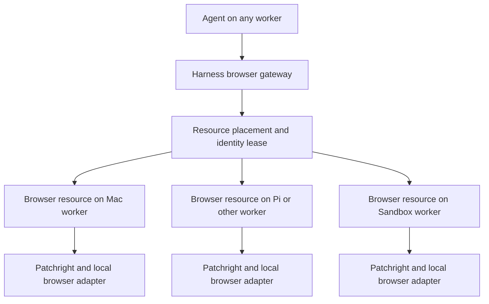

# Browser resources across workers

Updated: 2026-10-22. Host-independent resource model agreed. The initial extension transport is now implemented and fixture-tested; real-account
validation requires installing/pairing the extension in the selected profile.

The required behavior is to use a compatible Chrome/browser resource hosted on
any capable worker: Mac, Pi, other machines or provisioned Sandbox workers. Agent
and browser placement are independent. Existing authenticated profiles should be
usable without repeated connection approval, and desktop automation should avoid
taking focus from the owner's work. Existing browser gateway ownership,
workspace policy, operation ledger and manual-control rules continue to apply.
The owner requires Patchright as the automation driver, including when an
extension supplies the connection. Ordinary Playwright MCP is not a substitute.

## Findings

1. **The previous permission-based CDP adapter needs connection approval.** Chrome
   documents an Allow prompt when an agent connects. The previous lifecycle disconnected after idle tab release, repeatedly requiring
   approval. Retaining a connection reduces prompts but does not solve reconnects
   after worker/browser restarts. The default path is now a paired extension.
   [Chrome auto-connect](https://developer.chrome.com/docs/devtools/agents/use-cases/auto-connect)

2. **Launching Playwright against the everyday profile is unsupported.**
   `launchPersistentContext(userDataDir)` supports persistent automation profiles,
   but Playwright explicitly warns against the default Chrome user-data directory.
   Two browser instances cannot share a live directory. Chrome 136+ also restricts
   remote-debugging command-line flags for its default data directory.
   [Playwright BrowserType](https://playwright.dev/docs/api/class-browsertype#browser-type-launch-persistent-context),
   [Chrome restriction](https://developer.chrome.com/blog/remote-debugging-port)

3. **Microsoft already provides an extension using existing Chrome state.**
   Playwright MCP's extension mode reuses authenticated sessions. Its documented
   `PLAYWRIGHT_MCP_EXTENSION_TOKEN` authenticates subsequent connections without
   its per-connection approval dialog. The token belongs to a particular Chrome
   profile; explicitly selecting the profile avoids connecting to whichever was
   last used. Its docs describe separate tab groups for multiple clients.
   This is documented functionality, not yet validated on the owner's browser.
   [Extension README](https://github.com/microsoft/playwright/blob/main/packages/extension/README.md)

4. **The stock extension needs a background-operation assessment.** Current
   upstream source calls `chrome.tabs.update(..., {active: true})` and
   `chrome.windows.update(..., {focused: true})` during connection. Its connection
   page accepts only loopback relay addresses. Remote agents should use the worker
   hosting that browser as the intermediary, rather than exposing the relay on the
   network. The Mac is one possible browser host.
   Version-pin both sides before validating behavior; upstream source can differ
   from the installed Web Store release.
   [Connection handler](https://github.com/microsoft/playwright/blob/main/packages/extension/src/background.ts),
   [Loopback check](https://github.com/microsoft/playwright/blob/main/packages/extension/src/ui/connect.tsx)

5. **A custom extension is feasible without replacing the automation engine.**
   Chrome's debugger extension API transports CDP commands for individual tabs.
   Playwright itself connects to its extension through a local CDP relay.
   A thin extension or maintained fork could provide pairing, background tabs,
   workspace grants and disconnect controls while retaining a browser adapter.
   Compatibility with our pinned Patchright version must be tested.
   Native messaging is another local transport option; it requires an installed,
   extension-origin-restricted helper. Claude Code documents a native messaging
   host in its extension setup, providing a useful architectural reference.
   [Debugger API](https://developer.chrome.com/docs/extensions/reference/api/debugger),
   [Playwright factory](https://github.com/microsoft/playwright/blob/main/packages/playwright-core/src/tools/mcp/extensionContextFactory.ts),
   [Native messaging](https://developer.chrome.com/docs/extensions/develop/concepts/native-messaging),
   [Claude integration](https://code.claude.com/docs/en/chrome)

## Agreed resource model

A browser is an independently placed worker resource. It can be on the same
worker as the agent or another reachable worker. The resource abstraction is the
same on physical machines and provisioned Sandboxes; compatible browser binaries,
architecture, memory and lifecycle determine eligibility.

| Concept | Responsibility |
| --- | --- |
| Worker | Advertise resource capabilities, availability and resource budgets; host agent execution, browser resources or both. |
| Browser resource | A browser endpoint/instance, host worker, backend, compatible runtime versions, capacity, lifetime and health. |
| Browser identity | The account/profile binding, authorization policy, supported durable-state references and current validated location. |
| Browser lease | Exclusive controller, ownership generation and session-owned tabs; independent of agent placement. |

These are target domain responsibilities. Explicit resource registration and
identity bindings remain implementation tasks. The current broker selects healthy
hosts from worker reports, prefers the task worker for new/idle work and excludes
disconnected extensions. It no longer imposes a global personal-Chrome preference.

The browser adapter can connect through a paired extension and local relay to an
existing signed-in browser, or supervise a managed persistent/ephemeral browser.
Both expose the same scoped browser tools, screenshots and manual takeover.
Extension pairing is a connection mechanism for supported browser hosts; it is
not a requirement that every Pi or Sandbox run a desktop extension. All paths
retain Patchright as the automation client. Extension support on each host/runtime
must be validated rather than inferred from worker enrollment.

For example, a Sandbox agent can use a persistent browser on the Pi. An agent on
the Mac can use a separately provisioned Sandbox browser for a public-web task.
An agent on the Pi can use an available paired desktop browser for an account
that is currently authenticated there. A browser-only Sandbox can be provisioned
without moving the agent into that Sandbox.

## Placement, authentication and lifecycle

Browser placement considers the requested identity, allowed workspaces/domains,
backend capabilities, validated authentication, host availability, free browser
slots, memory/CPU budget, architecture, lifetime and durability requirements.
An unavailable desktop must not block browser work on eligible hosts. Each host
uses its own persistent login state; request manual takeover when signed out.
Account-specific resource bindings remain a separate follow-up.
Return a concrete wait reason when no resource can satisfy the request.

Pair existing profiles during setup. Keep connection credentials in browser-host
secret storage, outside model context. Agents receive scoped gateway tools; raw
extension MCP/relay access must not bypass leases or workspace policy. Keep browser
transport local to its host worker and route remote commands through authenticated
worker/control-plane channels. Support designated background tabs, account
validation and visible pairing/revocation controls. Connection pairing does not
remove website MFA, CAPTCHA or expired-session requirements.

Resource location does not by itself make authentication portable. On host loss,
use another resource only if it provides the required authorized identity or can
restore and validate supported state. Otherwise pause with an actionable reason.
A public-web task can use another eligible browser without requiring the owner's
desktop profile. Preserve unknown outcomes for actions that may already have
reached a service; changing browser hosts must not replay interrupted native work
or uncertain external mutations.

Persistent browser resources retain supported authenticated state across idle
shutdowns and agent changes. Ephemeral resources keep checkpoints, artifacts and
supported encrypted state outside the Sandbox and publish their expiry. Schedule
only compatible work within that lifetime; drain and checkpoint before planned
teardown, and reconcile after unexpected loss. Do not promise that a whole live
profile or device-bound credentials can be restored on another host.

Browser capacity and leases are independent of agent slots. A browser starts when
needed and releases idle compute while retaining supported durable state. Loss of
a browser resource can pause its dependent task without blocking unrelated tasks
or resource pools. No warm model process is needed to retain a browser identity.

## Validation before choosing stock extension versus a thin fork

- [ ] Use the pinned Patchright client against an extension-backed relay. Stock
  Playwright MCP constructs a Playwright client internally; merely configuring
  extension mode does not replace that client with Patchright.
- [ ] Inspect CDP traffic for driver/relay-introduced automation signals, including
  unexpected `Runtime.enable` and `Console.enable` calls. Patchright documents
  avoiding these commands as part of its driver patches. Its browser launch-flag
  adjustments cannot be retroactively applied to an already running Chrome, and
  existing Chrome plus an extension is not automatically equivalent to a browser
  launched with Patchright's recommended settings. Test real target services;
  avoiding all blocking/CAPTCHAs is not a guaranteed result.
- [ ] Pin a compatible extension/client version and test token-based reconnects
  after idle release, worker restart, Chrome restart and network interruption.
- [ ] Verify existing account access without exporting Chrome profile data.
- [ ] Verify connection, navigation and screenshots preserve foreground focus.
- [ ] Confirm tab cleanup preserves user tabs and current browser state.
- [ ] Test two workspace/session clients, ownership takeover and revocation.
- [ ] Register explicit browser resources, capabilities, identity bindings and
  health on all supported worker classes, independent of agent execution.
- [ ] Replace global personal-Chrome preference with per-resource/identity policy;
  verify an offline desktop does not block eligible Pi or Sandbox browser work.
- [ ] Test an agent using a browser on another worker, including Pi-hosted browsers
  and independently provisioned Sandbox browsers after runtime validation.
- [ ] Test host loss, supported-state restoration, identity validation and visible
  pause when another resource cannot satisfy the required account binding.
- [ ] Test ephemeral browser expiry, durable checkpoints and resource-budget
  admission without moving or keeping an agent process alive.
- [ ] Measure idle worker/relay memory without keeping model processes alive.
- [ ] Select the stock extension if it meets the requirements; otherwise adapt
  its relay design with a thin extension/fork that supports background operation.

Recommendation: implement one host-independent browser-resource interface with
Patchright, extension-backed existing profiles and managed browsers as adapters.
Evaluate reuse of Playwright's extension/CDP relay for existing profiles, with
compatibility and foreground behavior as explicit acceptance gates. Place each
resource on any eligible worker, independently of where the agent executes.

Patchright references:
[Driver patches](https://github.com/Kaliiiiiiiiii-Vinyzu/patchright#patches),
[Node package](https://github.com/Kaliiiiiiiiii-Vinyzu/patchright-nodejs).

## Implemented initial adapter (2026-10-22)

`apps/browser-extension` supplies a thin MV3 extension with one-time pairing,
background-only owned tabs, automatic reconnect and disconnect controls. The worker
hosts an authenticated loopback relay in-process; Patchright connects directly to
its CDP endpoint. The tab/session model is adapted from Microsoft's Apache-2.0
Playwright implementation, with provenance retained under `packages/browser/src/vendor`.
No vanilla Playwright client is used to drive pages.

Real headless Chrome fixtures verify reuse of an existing login, authenticated
CRM row reads through a canvas editor's HTML view, preserved foreground focus,
owned-tab cleanup, idle reuse and automatic reconnect after relay restart. Unauthorized
clients, website origins and invalid pairing are rejected. This is fixture validation;
the owner's actual account remains pending one-time extension installation/pairing.
