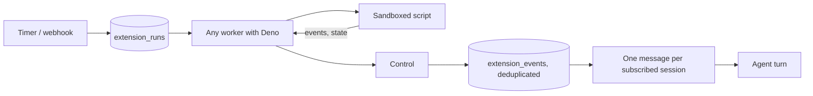

# Extensions

Extensions let the harness react to the outside world without spending agent
turns on polling. An extension is a small script that runs on a timer or when
its webhook is called, with no model involved. When it finds something new it
emits events, and the harness sends them as one message to each conversation
subscribed to the extension. That conversation's agent then continues, for
example by drafting a reply.

Site-specific code (Reddit, Discord, LinkedIn, an RSS feed, a CRM) lives in
extensions, outside this repository. The harness provides only the contract
below, the sandbox, and delivery.

## How it fits together



- **Control** keeps extensions, their revisions, settings, saved state, runs and
  events. Its maintenance loop fires cron triggers and fails runs whose worker
  stopped responding. The public `/api/hooks/<id>/<trigger>/<token>` route
  stores a webhook request as a run.
- **Workers** that have Deno report the `deno` label and take runs one at a
  time beside their agent lanes. Owners can pin an extension to labels (for
  example a machine that is always on). One run per extension executes at a
  time, so its saved state stays consistent.
- **Delivery.** A completed run's events are deduplicated by key. New ones
  reach each subscribed session as a single message. A session may subscribe to
  some event types only. The owner subscribes conversations in the UI; agents
  can subscribe their own conversation with `extension_subscribe`.

## Approval

Every install or change is a **revision** that waits for the owner, whether it
was installed from a URL, pasted, or proposed by an agent (`extension_propose`).
The review shows the hosts the script can reach, its triggers and settings, any
newly added host, and the full script. Approving a revision makes it the one
that runs; approving an earlier approved revision rolls back. Runs queued for a
previous revision are cancelled.

## Sandbox

Scripts run with `deno run --no-prompt` and only `--allow-net=<hosts from the
manifest>`. They cannot read or write files, read the environment, start
programs, or reach other hosts. Nothing from the worker's environment is passed
in. Memory is capped at 256 MB and the run is killed after its timeout. Settings
(secrets included) arrive in the script's input; secrets are stored encrypted on
the control and are opened only for the worker running that run.

Deno was chosen over Bun and Node because its permissions make third-party code
safe to run without a container. The contract uses only web-standard APIs, so
another runtime can be added later by declaring a different `runtime`.

## The package

An extension is a folder with `manifest.json` and one module, `main.ts` by
default:

```json
{
  "id": "reddit-inbox",
  "name": "Reddit inbox",
  "description": "Sends new replies and messages from a Reddit inbox.",
  "version": "1.0.0",
  "runtime": "deno",
  "main": "main.ts",
  "permissions": { "net": ["www.reddit.com", "oauth.reddit.com"] },
  "timeoutSeconds": 60,
  "config": {
    "properties": {
      "clientId": { "type": "string", "title": "App client ID" },
      "clientSecret": { "type": "string", "title": "App secret", "secret": true },
      "refreshToken": { "type": "string", "title": "Refresh token", "secret": true }
    },
    "required": ["clientId", "clientSecret", "refreshToken"]
  },
  "triggers": [{ "name": "poll", "type": "cron", "cron": "* * * * *", "timezone": "UTC" }]
}
```

| Field | Meaning |
| --- | --- |
| `id` | 2–50 lowercase letters, digits or dashes. Revisions share it. |
| `permissions.net` | Up to 20 exact host names (optionally `:port`). Empty means no network. |
| `timeoutSeconds` | 1–300, default 60. |
| `config.properties` | Settings the UI renders as a form: `type` (`string`, `number`, `integer`, `boolean`), `title`, `description`, `enum`, `default`, and `secret: true` for values that are stored encrypted and never shown again. |
| `config.required` | Settings that must have a value (or a default) before the extension runs. |
| `triggers` | 1–10 of `{name, type: "cron", cron, timezone?}` (five fields, default UTC) and `{name, type: "webhook"}`. |

The module's default export receives a context:

```ts
export default async function run(ctx: {
  trigger: { name: string; type: "cron" | "webhook" | "manual" };
  /** Webhook runs: the request. Manual runs: { manual: true }. Timer runs: null. */
  request: { method: string; query: Record<string, string>; headers: Record<string, string>; body: string } | { manual: true } | null;
  config: Record<string, string | number | boolean>;
  state: {
    get(key: string): unknown;
    set(key: string, value: unknown): void; // JSON, at most 256 KB in total
    delete(key: string): void;
  };
  emit(event: Event | Event[]): void;
  log(...values: unknown[]): void; // console.* also goes to the run's log
  signal: AbortSignal; // aborts at the timeout
}): Promise<void>;

interface Event {
  key: string;     // stable identity; a key seen before is dropped
  title: string;   // one line, shown as the heading in the conversation
  text?: string;   // up to 8000 characters
  url?: string;    // link to the item
  type?: string;   // lets sessions subscribe to some types only
  data?: unknown;  // up to 16 KB of JSON, kept with the event
}
```

A run either succeeds or changes nothing: if the script throws, its state
changes and events are dropped, so the next run starts from the same point. A
run may emit up to 100 events; keep a cursor in `state` and emit the rest next
time. Use the item's own ID as the event key so repeated reads never deliver
twice.

```ts
export default async function run(ctx) {
  const since = (ctx.state.get("since") as string | undefined) ?? "";
  const items = await fetchNewItems(ctx.config, since, ctx.signal);
  for (const item of items)
    ctx.emit({ key: item.id, title: item.subject, text: item.body, url: item.link, type: item.kind });
  if (items.length) ctx.state.set("since", items.at(-1).id);
}
```

Keep scripts small and dependency-free where possible. `npm:` and `jsr:` imports
work but run unreviewed code at whatever version resolves, so pin exact versions.

## Installing

Open **Extensions → Add extension** and paste the raw URL of `manifest.json`;
the control downloads `main` from the same site. Or paste both files. Review,
approve, fill in the settings, and choose the conversations that should receive
events. **Run now** runs a trigger immediately. Each run's status, events, log
and error are listed under the extension.

## Later

- **Tools.** Extensions declaring agent-callable tools, served through the
  existing harness MCP gateway.
- **Services.** Long-running extensions (for example a chat bot holding a
  gateway connection) as containers on one worker with a lease.
